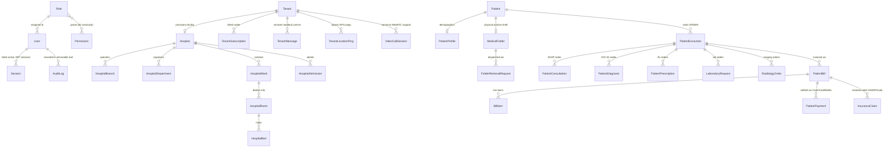

# GBS Hospital Management System — PostgreSQL Entity-Relationship Diagram (ERD)

**Database Engine:** PostgreSQL (via Prisma ORM — `Backend/prisma/schema.prisma`)  
**Total Models:** 124 Relational Models across 17 Enterprise Domains  
**Multi-Tenant Keying:** `Tenant` (`tenantId`, `tenantCode`, `institutionId`) ↔ `Hospital` (`hospitalId`)

---

## 1. Core Architecture & Relational Overview

---

## 2. Complete Domain Inventory (116 PostgreSQL Models)

| # | Enterprise Domain | Models Included | Primary Keys / Business Identifiers |
| :-: | :--- | :--- | :--- |
| **1** | **Identity, RBAC & Sessions** | `Role`, `Permission`, `User`, `Session`, `AuditLog` | UUID PKs, 16 Blueprint Roles, 82 Unified Permissions, SHA-256 Session Token Digests |
| **2** | **Multi-Tenant & Developer Governance** | `Tenant`, `TenantSubscription`, `TenantMessage`, `TenantLocationPing`, `VideoCallSession`, `DeveloperAccessGrant` | `TEN-YYYY-XXXXXX`, `GBS-ACC-XXXX`, `INS-YYYY-XXXXXX`, `SUB-YYYY-XXXXXX` |
| **3** | **Hospital Facility & Bed Matrix** | `Hospital`, `HospitalBranch`, `HospitalSetting`, `HospitalRoom`, `HospitalDepartment`, `HospitalWard`, `HospitalBed`, `HospitalStaff`, `HospitalUnit`, `HospitalPatientLocation`, `HospitalAdmission` | Hierarchical Ward → Room → Bed occupancy tracking |
| **4** | **Patient MPI & Physical Archive** | `Patient`, `PatientProfile`, `PatientMedicalRecord`, `PatientAllergy`, `MedicalFolder`, `FolderRetrievalRequest`, `FolderMovementLog` | `MRN-YYYY-XXXXXX`, Shelf Barcode (`SHELF-A1-BAY04-RACK02`), Chain-of-Custody logs |
| **5** | **OPD, Triage & Clinical Care** | `OpdQueueTicket`, `PatientEncounter`, `PatientConsultation`, `PatientDiagnosis`, `PatientPrescription`, `PatientVitalSign`, `PatientMedication`, `PatientClinicalNote`, `NursingRecord`, `DischargeRecord`, `ClinicalWorkflow` | `OPD-001` / `EMG-001`, `ENC-YYYY-XXXXXX`, Adult NEWS2 Physiological Scoring |
| **6** | **Pharmacy & Medication Inventory** | `PharmacyItem`, `PharmacyInventory`, `PharmacyBatch`, `PrescriptionDispense`, `PrescriptionDispenseItem`, `PharmacyStockMovement` | Batch Lot Numbers, Expiry Tracking, FEFO Dispensing |
| **7** | **Laboratory & Pathology** | `LaboratoryRequest`, `LaboratorySample`, `LaboratoryTestResult`, `LaboratoryCatalogItem` | Sample Barcode Tracking, Reference Range Flagging |
| **8** | **Radiology & PACS** | `RadiologyOrder`, `DicomStudy`, `RadiologyReport`, `RadiologyCatalogItem` | Modality Studies (`X-RAY`, `CT`, `MRI`, `US`), Radiologist Sign-Off |
| **9** | **Billing, Finance & NHIA Claims** | `PatientBill`, `BillItem`, `PatientPayment`, `InsuranceClaim`, `BillingTariffItem`, `NhiaClaimBatch`, `NhiaClaimItem`, `NhiaReconciliationVoucher`, `NhisMemberPolicy` | Cash / Card / Mobile Money / Bank Transfer / NHIA G-DRG Claims Batches |
| **10** | **Surgery, OT & PACU** | `OperatingTheatre`, `SurgicalCase`, `SurgicalChecklist`, `AnesthesiaRecord`, `PacuRecord`, `SurgicalCatalogItem` | WHO Surgical Safety Checklist, Pre-Op/Intra-Op/PACU Recovery |
| **11** | **Emergency, Ambulance, Blood Bank & Mortuary** | `Ambulance`, `AmbulanceDispatch`, `EmergencyCase`, `BloodDonor`, `BloodUnit`, `BloodTransfusionRequest`, `BloodCrossMatch`, `BloodTransfusionRecord`, `CorpseRecord`, `MortuaryChamber`, `AutopsyCase`, `CorpseRelease` | Emergency Bypass Protected (`X-Tenant-Emergency-Access: ACTIVE_AUDITED`) |
| **12** | **Biomedical & Supply Chain Procurement** | `MedicalEquipment`, `MedicalWorkOrder`, `EquipmentCalibration`, `ProcurementVendor`, `VendorContract`, `PurchaseOrder`, `PurchaseOrderItem`, `GoodsReceiptNote`, `GoodsReceiptItem` | 3-Way Match Verification (PO ↔ GRN ↔ Invoice) |
| **13** | **HR, Credentialing & Quality / IPC** | `StaffCredential`, `DutyShiftRoster`, `ShiftHandover`, `StaffAttendance`, `StaffLeaveRequest`, `ClinicalIncident`, `InfectionControlCase`, `ClinicalAudit`, `CorrectiveActionPlan`, `PatientSafetyAlert` | License Verification, Shift Co-Sign, CAPA Audits |
| **14** | **Migration, GIS, Telemedicine & Biometrics** | `MigrationJob`, `MigrationRecordItem`, `MigrationTemplate`, `FacilityGeofence`, `GeofenceBreachEvent`, `FacilityFloorPlan`, `TelemedicineConsultation`, `BiometricVoiceprint`, `BiometricSecurityCredential`, `BiometricVerificationLog`, `BiometricSecurityPolicy` | Central Voice Authentication Platform Service (`VOX-YYYY-XXXXXX`), `TEL-YYYY-XXXXXX` |
| **15** | **GBS-RCCE Control, Events & Resilience** | `SystemEvent`, `SystemNotification`, `IdempotencyRecord`, `SystemErrorLog`, `SystemConfiguration` | Immutable Audit Chain, Idempotency Keys, Dynamic Config, Reset/MFA Challenges |
| **16** | **Clinical Specialties, ICU, Safety & AI Clinical** | `DentalRecord`, `EyeClinicRecord`, `IcuMonitoringRecord`, `ClinicalSafetyOverride`, `AiClinicalSuggestion` | `DEN-YYYY-XXXXXX`, `EYE-YYYY-XXXXXX`, `ICU-YYYY-XXXXXX`, `OVR-YYYY-XXXXXX`, `AIC-YYYY-XXXXXX` |
| **17** | **Online Meetings, Document Versioning & Facility Ops** | `HospitalMeeting`, `HospitalDocument`, `FacilityTask` | `MTG-YYYY-XXXXXX`, `DOC-YYYY-XXXXXX` (SHA-256 + 7-yr retention), `FAC-YYYY-XXXXXX` |

---

## 3. Indexing, Constraints & Integrity Guarantees
- **Unique Natural Identifiers:** `User.email`, `Role.name`, `Permission.name`, `Tenant.tenantId`, `Tenant.tenantCode`, `Tenant.officialEmail`, `Patient.mrn`, `SystemConfiguration.configKey`, `IdempotencyRecord.idempotencyKey`.
- **Transactional Integrity:** Multi-step clinical, pharmacy dispense, billing payment, tenant provisioning, and password reset mutations execute inside `prisma.$transaction(...)`.
- **Audit & History Retention:** `AuditLog`, `FolderMovementLog`, `PharmacyStockMovement`, `BiometricVerificationLog`, `SystemEvent`, and `SystemErrorLog` preserve append-only historical trails for healthcare compliance.
